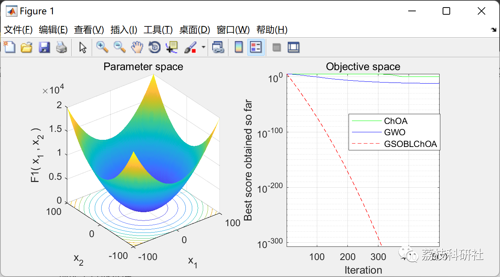
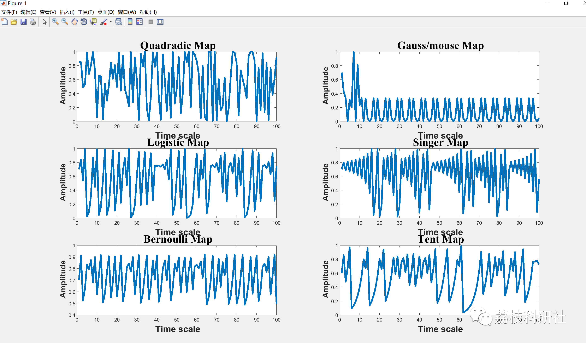

# Chimpanzee Optimization Algorithm for Multimodal Engineering Problems Based on Weighted Contraposition and Greedy Search (Matlab Code Implementation)

💥💥💞💞 Welcome to this blog❤️❤️💥💥
🏆 Bloggers' Advantages: 🌞🌞🌞 The content of the blog strives for rigorous thinking and clear logic, making it convenient for readers.
⛳️ Mantra: "Those who travel a hundred miles may finish it in ninety."
Litchi Research Society
Code Collection: Power Systems, Intelligent Algorithms and Applications, Neural Network Prediction, Path Planning, Optimized Scheduling, Workshop Scheduling, Image Processing, Signal Processing...
🎁 List of Special Sections Links:
🌈🌈🌈🌟🌟🌟 Electrical Code Intelligent Algorithms and Their Applications Path Planning Neural Network Prediction Optimized Scheduling Image Processing Workshop Scheduling Signal Processing Romantic Her Thoughts My Philosophy Math Modelling Complete Code Matters
💥1 Overview
Improved Black-and-White Optimization Algorithm (ChOA), which uses Greedy Search (GS) and Opposite Learning (OBL) to enhance the exploration and development capabilities of ChOA in solving real engineering constraint problems. To study the efficiency of GSOBL-ChOA, its performance was evaluated on 23 standard benchmark functions, 10 benchmark functions from CEC06-2019, randomly generated landscapes, and 12 actual constrained optimization problems (COPs-2020). These problems cover a wide range of engineering fields, including power system design, integrated and process design, industrial chemical manufacturers, power electronics design, mechanical design, and animal feed allocation. The results were compared with those obtained using benchmark optimizers such as CMA-ES and SHADE, who won the competition at the CEC; standard ChOA; OBL-GWO, OBL-SSA, and OBL-CSA as best baseline algorithms based on OBL. For a comprehensive evaluation, three non-parametric statistical tests were used, including Wilcoxon rank sum, Bonferroni-Dunn, and Hochberg-Khatri, and Friedman's average rank test. The top two algorithms were GSOBL-ChOA and CMA-ES, scoring 40 and 11 points respectively out of 27 mathematical functions. jDE100 achieved the highest score of 100 points in the 100-player challenge, followed by DISHchain1e+12 with a score of 97 points, and GSOBL-ChOA scored 93rd with a fourth-highest score. Finally, GSOBL-ChOA and CMA-ES performed better than other benchmarks in five and four actual COPs, respectively.
📚2 Run Results
🎉3 References
[1] Mirjalili, S., Mirjalili, S. M., & Lewis, A. (2014). Grey Wolf Optimizer. Advances in engineering software, 69, 46-61.
🌈 4 Matlab code implementation
Click the article's lower left corner to read more.

## Images

<!-- PAYMENT_BLOCK -->

## Get this dataset

- Payment link (Stripe): [Buy now](https://buy.stripe.com/3cs8yP7sY87d0vu9AB)
- Payment QR code: 

<!-- /PAYMENT_BLOCK -->
